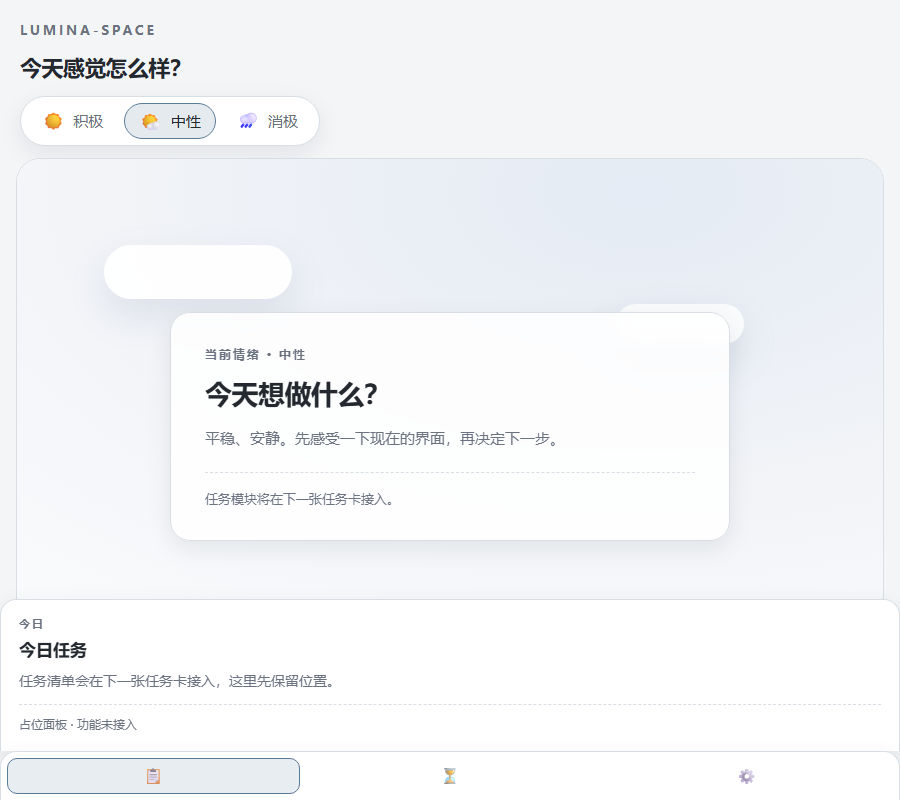

<p align="center">
  
</p>

<h1 align="center">Lumina-Space</h1>

<p align="center">
  <strong>把情绪和待办放在同一张书桌上的沉浸式学习工作台。</strong><br>
  选一个情绪，界面和场景跟着变；先感受，再开始。
</p>

<p align="center">
  <a href="https://lumina-space.cc.cd"></a>
  <a href="LICENSE"></a>
  
  
  
  
</p>

<p align="center">
  <a href="#为什么是-lumina-space">为什么</a> ·
  <a href="#现在能做什么v02">功能</a> ·
  <a href="#截图">截图</a> ·
  <a href="#快速开始">快速开始</a> ·
  <a href="#技术栈">技术栈</a> ·
  <a href="#版本">版本</a> ·
  <a href="#参考与致谢">致谢</a> ·
  <a href="https://lumina-space.cc.cd"><strong>打开网页版 →</strong></a>
</p>

---

## 为什么是 Lumina-Space

大多数待办工具只问「做完了吗」。但大学生一天里真正难的那部分，往往发生在打开待办之前：不想开始、不知道自己怎么了、坐下来又静不下来。

Lumina-Space 想把「情绪」放回工作台的第一屏。不是加一个心情打卡，而是让整个界面先接住你：暖一点、冷一点、亮一点、安静一点。然后再问，今天想做什么。

> 这是一张干净的书桌，不是一张 KPI 看板。

## 现在能做什么（v0.2）

- **情绪圆盘**：左上角圆形情绪盘，鼠标移入 / 点击 / Enter 展开积极 / 中性 / 消极三个选项；选中后整站切换 CSS 变量主题，刷新后保持。
- **全屏主界面**：Stage 铺满整个视口，不再是一张带留白的圆角卡片；中央内容卡片保持居中。
- **情绪场景**：主界面 Stage 随情绪变化——暖阳、阴天、雨夜；只做简单 CSS 场景，不加载 3D。
- **左下侧边栏**：今日 / 专注 / 设置三个入口，展开占位面板；Esc 收起；窄屏变底部抽屉。
- **本地优先**：数据只存在浏览器 `localStorage`，没有账号、没有后端。
- **基础质量**：键盘可达、焦点可见、`prefers-reduced-motion` 关闭动效；21 条单元测试。

> v0.2 进行中：任务 CRUD 是下一步；番茄钟、情绪记录、3D 小屋还没做。

## 截图

| 积极 | 中性 | 消极 |
|---|---|---|
|  |  |  |

**情绪圆盘 / 窄屏**




## 快速开始

```bash
git clone https://github.com/Kensh-ux/Lumina-Space.git
cd Lumina-Space
npm install
npm run dev
```

打开终端提示的地址（默认 `http://localhost:5173`）。

| 命令 | 说明 |
|---|---|
| `npm run dev` | 启动开发服务器 |
| `npm run build` | 类型检查 + 生产构建，输出 `dist/` |
| `npm run preview` | 本地预览构建产物 |
| `npm run check` | TypeScript 类型检查 |
| `npm test` | 跑一次单元测试 |
| `npm run test:watch` | 监听模式跑测试 |

开发辅助参数（仅 Dev 生效）：`?theme=positive|neutral|negative`、`?dial=open`、`?panel=today|focus|settings`。

## 技术栈

| 层 | 选择 | 说明 |
|---|---|---|
| 构建 | Vite 8 | 轻量、快、无 SSR |
| UI | React 19 + TypeScript 6 | 函数组件 + Hooks |
| 样式 | 原生 CSS + CSS 变量 + CSS Modules | 主题用变量切换；不引 Tailwind / UI 库 |
| 状态 | `useState` / `useReducer` / Context | 暂不引状态库 |
| 存储 | `localStorage` + 自封装 adapter | 单键 `lumina:data` + `lumina:theme` 镜像 |
| 测试 | Vitest + jsdom | 纯逻辑优先 |
| 部署 | 静态 `dist/` | 可接 Cloudflare Pages / 任意静态托管 |

## 项目结构

```
src/
  app/              页面壳：App、Sidebar、Stage
  features/mood/    情绪常量、圆盘、useMood
  lib/              类型、存储 adapter
  styles/           主题令牌、全局样式
tests/              与 src 对应的纯逻辑测试
docs/
  screenshots/      README 截图
  tasks/            任务卡
```

## 版本

| 版本 | 日期 | 内容 | 状态 |
|---|---|---|---|
| **v0.1** | 2026-10-22 | 框架、情绪主题、左下侧边栏、Stage 场景、本地持久化、18 tests | 已上线 |
| v0.2 | 进行中 | 全屏主界面、情绪圆盘；任务 CRUD 下一步 | 进行中 |
| v0.3 | 计划 | 番茄钟、情绪记录、主题扩展、动效、3D 预研 | 计划中 |

## 线上地址

**https://lumina-space.cc.cd**

纯静态站点，构建产物在 `dist/`，没有后端。

### Cloudflare

当前线上是 Cloudflare Worker（GitHub 集成）+ 自定义域名 `lumina-space.cc.cd`：

- Build command：`npm run build`
- Build output directory：`dist`
- Node：22
- 自定义域名：`lumina-space.cc.cd`

以后 `git push` 到 `main` 自动更新，不需要 wrangler。

> `*.workers.dev` / `*.pages.dev` 在中国大陆不可达；本项目已经绑定 `cc.cd` 自定义域名。

## 参考与致谢

这个项目的设计从几个开源项目里学到了很多；**v0.1 没有直接复制它们的源代码**，只借鉴了数据模型、状态机、主题和动效思路。完整审计见 [`THIRD_PARTY_NOTICES.md`](THIRD_PARTY_NOTICES.md)。

- [Super Productivity](https://github.com/super-productivity/super-productivity)（MIT）：任务模型、计时状态机、存储分层。
- [eDEX-UI](https://github.com/GitSquared/edex-ui)（GPL-3.0）：主题 JSON、启动动效、音频/模态框思路；未复制其代码。
- [HyperFrames](https://github.com/heygen-com/hyperframes)（Apache-2.0）：HTML/CSS/可 seek 动画 → 视频的代码绘图流程。
- [Lemo-Opuscar](https://github.com/lemomo-ai/lemo-opuscar)（MIT / CC BY 4.0）：全代码短片风格与动效技法。

> 如果未来复制/修改了上述项目的代码，会在 `THIRD_PARTY_NOTICES.md` 里登记来源、commit、许可证和改动，并在本段致谢。

## License

MIT © 四弦六狸。见 [`LICENSE`](LICENSE)。
