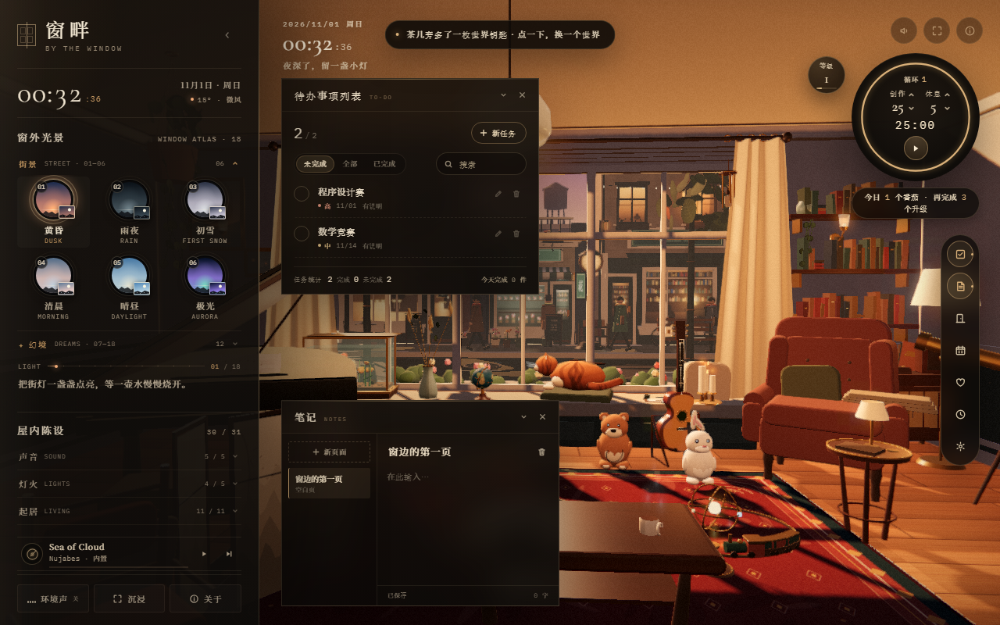
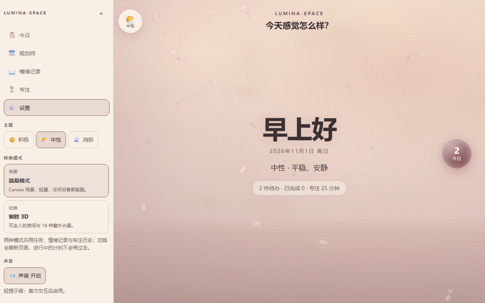
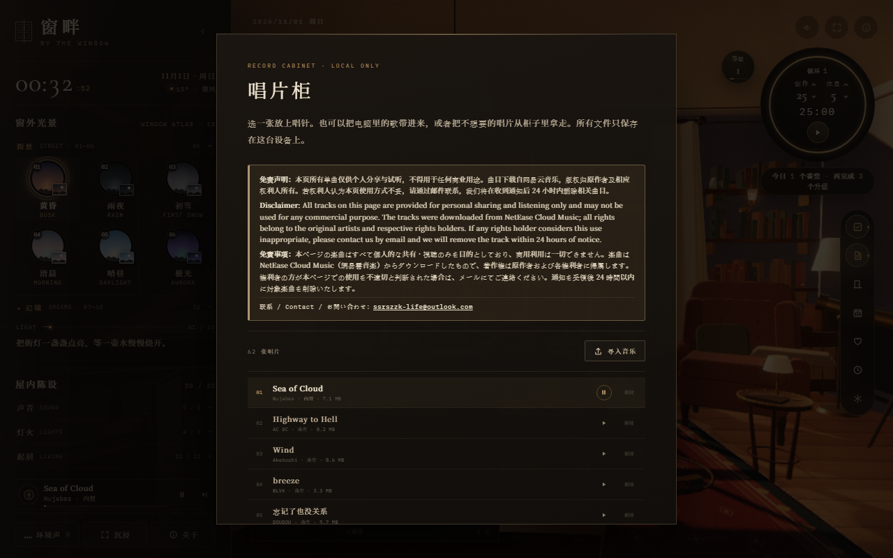

<p align="center">
  
</p>

<h1 align="center">Lumina-Space</h1>

<p align="center">
  <strong>把情绪和待办放在同一张书桌上的沉浸式学习工作台。</strong><br>
  选一个情绪，界面和场景跟着变；先感受，再开始。
</p>

<p align="center">
  <a href="https://lumina-space.cc.cd"><strong>在线使用 → lumina-space.cc.cd</strong></a>
</p>

<p align="center">
  <a href="LICENSE"></a>
  
  
  
  
  
</p>

<p align="center">
  <a href="#为什么是-lumina-space">为什么</a> ·
  <a href="#现在能做什么">功能</a> ·
  <a href="#截图">截图</a> ·
  <a href="#快速开始">快速开始</a> ·
  <a href="#版本记录">版本</a> ·
  <a href="CHANGELOG.md">更新日志</a>
</p>

---

## 为什么是 Lumina-Space

大多数待办工具只问「做完了吗」。但人们一天里真正难的那部分，往往发生在打开待办之前：不想开始、不知道自己怎么了、坐下来又静不下来。

Lumina-Space 想把「情绪」放回工作台的第一屏。不是加一个心情打卡，而是让整个界面先接住你：暖一点、冷一点、亮一点、安静一点。然后再问，今天想做什么。

> 这是一张干净的书桌，不是一张 KPI 看板。

## 现在能做什么

- **情绪圆盘**：左上角圆形情绪盘，鼠标移入 / 点击 / Enter 展开积极 / 中性 / 消极三个选项；选中后整站切换主题，刷新后保持。
- **双模式**：设置 →「转换模式」，一键从简易模式进入同源 `/room/` 的**窗畔 3D 模式**；3D 设置里可「回到简易模式」。两种模式共用任务、情绪记录与专注历史（同一个 `lumina:data`），切换会刷新页面，正在跑的计时不会带过去。
- **窗畔 3D**：可走入的窗边房间——18 种窗外光景、31 件陈设、唱片机与环境声，房间上叠加工作台（待办 / 笔记 / 番茄钟 / 规划师 / 情绪记录 / 设置）和三界之门。内置 **62 首**音乐。
- **主界面**：三套 Canvas 2D 场景——积极暖阳光束 / 流动光带 / 浮粒，中性黄昏暮色（雾团 / 纸片 / 暮色星座 / 水面 / 涟漪），消极雨丝 / 水面 / 涟漪 / 倒影；无中央大球，中心保留问候、日期与今日概况，右侧「今日」光球打开任务玻璃面板（新建 / 编辑 / 筛选 / 搜索），点外部或 Esc 回到主界面。
- **自定义背景**：设置里按积极 / 中性 / 消极分别上传、替换或恢复原先场景；推荐 1920×1080 横图（JPG / PNG / WebP，≤12MB），自动压缩后只存本机，有背景的场景用图片替换动态场景。有背景时欢迎语右上角的 `×` 可临时隐藏欢迎语，确认后刷新恢复。
- **规划师**：顶部显示 `2026年，10月` 这样的月份标题，随横向滚动跨月更新；右侧日期选择器选中任意一天，**那天成为第一列**，从起始日连续排 **365 天**，左右滑动看更多天。每列 180–220px，按截止日期分列，可添加 / 编辑 / 完成 / 删除；任务行显示优先级 / 时间，未排期计数。
- **待办任务**：大编辑器新建 / 编辑（标题、描述、截止日期 + 时间、优先级）；未完成按 **优先级 60% + 距今天数 40%** 排序（`11/01 高` 会排在 `10/31 低` 前面）；完成 / 取消完成 / 删除都有二次确认；今日栏只显示未完成，底部「任务统计」卡可展开已完成列表；全部 / 未完成 / 已完成筛选 + 标题搜索，默认未完成；任务多时列表滚动，卡片不会被压扁。
- **情绪记录**：侧栏新模块，点开是独立主视图。22 个内置情绪词（期待、喜悦、自豪、感动、满足、安心、怀念、焦虑、害怕、生气、羡慕、失落、委屈、孤独、疲惫、愧疚、自卑、迷茫、压抑、无聊、纠结、尴尬）右侧上下滑动选择，也可以自己写；配合事件描述与 **-724 ~ 597** 的事件好感值。支持**编辑 / 删除（二次确认）**、顶部**日期置顶**（选中日期那天的记录置顶，其余保持原顺序；该天没有记录则顺序不变）与**关键词搜索**（情绪词 + 事件描述）；编辑保存后原时间下会标出「再次编辑于」。列表最新在上、上下滚动，空态显示「当前还没有情绪记录」。
- **专注**：番茄钟完成时右下角弹出提醒 + 短促提示音（可静音）；统计显示今日与总计，可单独清除专注数据，不影响任务、情绪记录与背景设置。
- **左侧栏**：全高可折叠、可拖拽调宽（默认 300px，240–420，刷新保持）；今日 / 规划师 / 情绪记录 / 专注（番茄钟 + 今日/总计统计）/ 设置（转换模式 / 主题 / 自定义背景 / 声音 / 数据概况 + 导出 JSON）模块；窄屏变底部导航 + sheet。
- **轻音效**：hover / 点击 / 面板开合轻提示音，可一键静音；背景音乐在设置里全局开关，跨面板持续，随积极 / 中性 / 消极切换声景（**真实录音**：林间鸟鸣 / 蓝调东京夜驶·Lofi 旋律 / 平静雨声，各约 20 分钟无缝循环，托管在 GitHub Releases），`lumina:noise` 刷新保持；加载中会提示「由于网络原因，请耐心等待」。
- **本地优先**：数据只存在浏览器 `localStorage`，没有账号、没有后端；导出 JSON 会带上任务、情绪记录与专注记录。
- **基础质量**：键盘可达、焦点可见、`prefers-reduced-motion` 关闭动效；**236 条单元测试**。

> v2.0.0 已完成（2026-11-01）：简易模式 + 窗畔 3D 双模式、同源部署，数据共用。

## 截图

| 积极                                        | 中性                                       | 消极                                        |
| ----------------------------------------- | ---------------------------------------- | ----------------------------------------- |
|  |  |  |

**窗畔 3D 模式（同源 `/room/`）**



**转换模式与音乐免责声明**

| 简易模式设置 | 唱片柜三语免责声明 |
|---|---|
|  |  |

**规划师（可选起始日，连续 365 天）**


**情绪记录（编辑 / 删除 / 日期置顶 / 搜索）**


**今日任务与已完成统计**


**今日光球 / 设置 / 专注**


## 快速开始

```bash
git clone https://github.com/Kensh-ux/Lumina-Space.git
cd Lumina-Space
npm install
npm run dev
```

打开终端提示的地址（默认 `http://localhost:5173`）。

- 简易模式：`/`
- 窗畔 3D 模式：`/room/`（由 `public/room/` 提供；`npm run build` 会一起复制到 `dist/room/`）
- 两种模式必须同一 origin；Vite 开发服务器与 `vite preview` 都满足。

## 版本记录

| 版本 | 日期 | 内容 |
|---|---|---|
| **v2.0.0（当前，双模式）** | 2026-11-01 | 简易模式 + 窗畔 3D：18 种窗外光景 / 31 件陈设 / 房间工作台 / 三界之门；62 首内置音乐（中 / 英 / 日三语免责声明）；设置「转换模式」同源切换，任务 / 情绪 / 专注共用 |
| v1.3.3（简易模式） | 2026-10-28 | 情绪主题与场景、任务与 365 天规划师、专注（完成提醒 / 总计 / 单独清除）、情绪记录（编辑 / 删除 / 置顶 / 搜索）、自定义背景（欢迎语可隐藏） |

> **v2.0.0 是「双模式」：** 简易模式仍然只用 Canvas 2D + CSS，首屏极轻；3D 模式是独立静态应用，放在同源 `/room/`，两者共用 `lumina:data`，但 3D 的笔记、布局、唱片与专注偏好单独存放。切换会刷新页面，运行中的计时不会带过去。

完整历史（v0.1 起每个小版本）见 [CHANGELOG.md](CHANGELOG.md)。

免责声明：本页所有单曲仅供个人分享与试听，不得用于任何商业用途。曲目下载自网易云音乐，版权归原作者及相应权利人所有。若权利人认为本页使用方式不妥，请通过邮件联系，我将在收到通知后 24 小时内删除相关曲目。

Disclaimer: All tracks on this page are provided for personal sharing and listening only and may not be used for any commercial purpose. The tracks were downloaded from NetEase Cloud Music; all rights belong to the original artists and respective rights holders. If any rights holder considers this use inappropriate, please contact us by email and I will remove the track within 24 hours of notice.

免責事項：本ページの楽曲はすべて個人的な共有・視聴のみを目的としており、商用利用は一切できません。楽曲は NetEase Cloud Music（網易雲音楽）からダウンロードしたもので、著作権は原作者および各権利者に帰属します。権利者の方が本ページでの使用を不適切と判断された場合は、メールにてご連絡ください。通知を受領後 24 時間以内に対象楽曲を削除いたします。

联系 / Contact / お問い合わせ：ssrszzk-life@outlook.com

## License

MIT © 四弦六狸。见 [`LICENSE`](LICENSE)。
