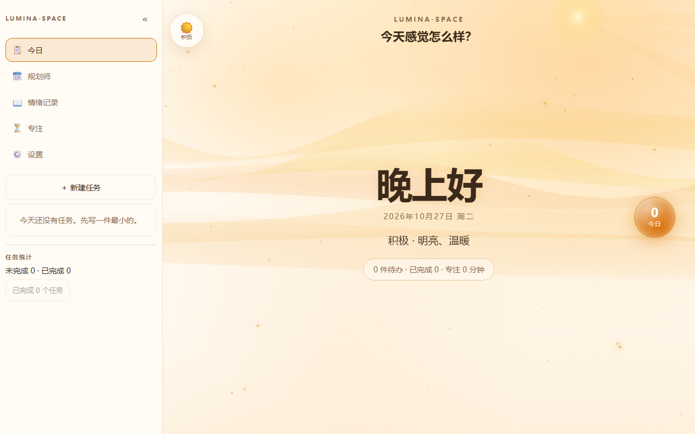
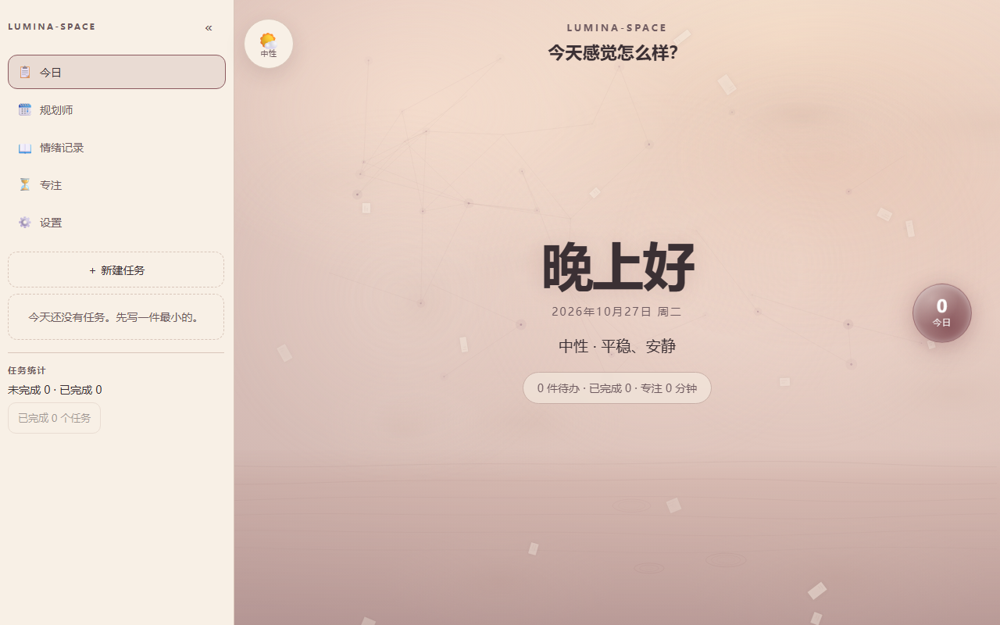
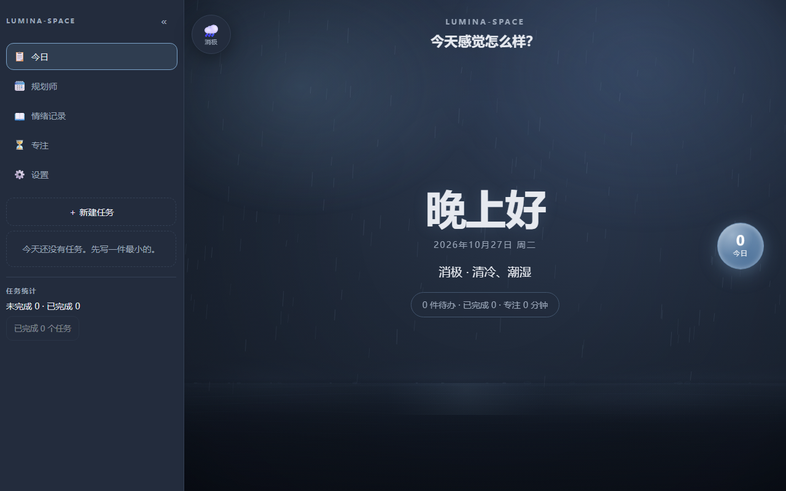
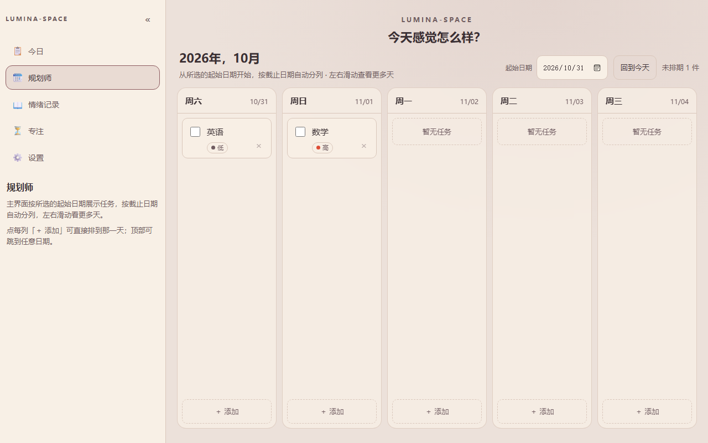
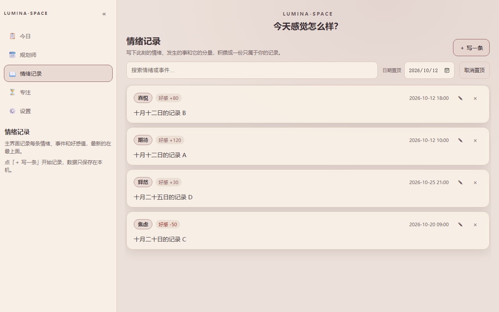
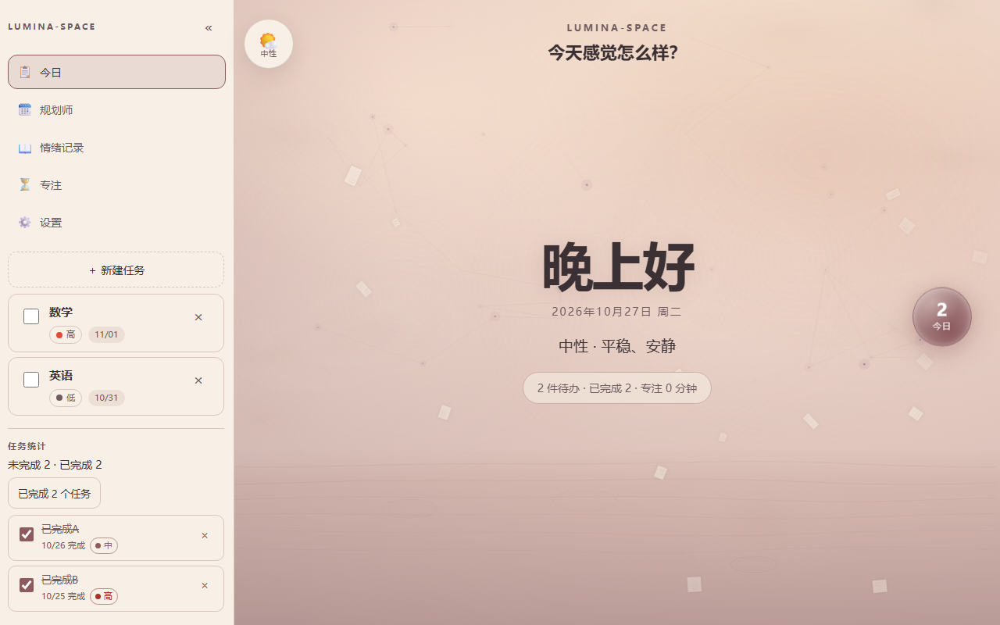
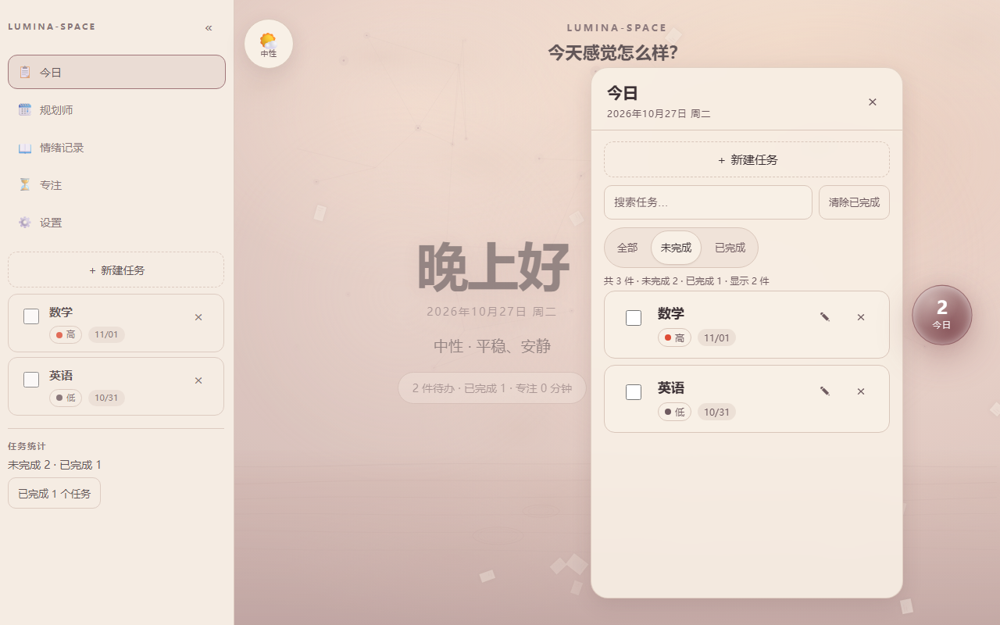
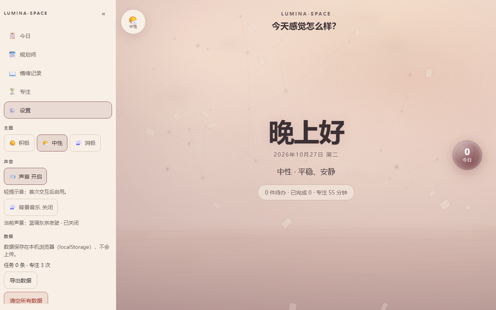
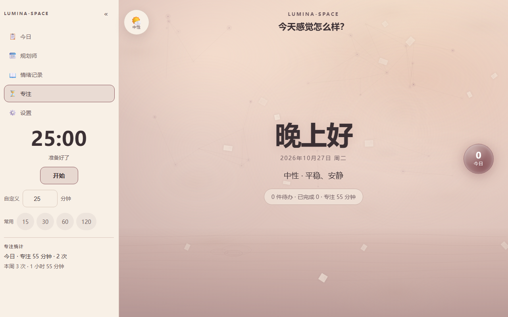

<p align="center">
  
</p>

<h1 align="center">Lumina-Space</h1>

<p align="center">
  <strong>把情绪和待办放在同一张书桌上的沉浸式学习工作台。</strong><br>
  选一个情绪，界面和场景跟着变；先感受，再开始。
</p>

<p align="center">
  <a href="https://lumina-space.cc.cd"><strong>在线使用 → lumina-space.cc.cd</strong></a>
</p>

<p align="center">
  <a href="LICENSE"></a>
  
  
  
  
  
</p>

<p align="center">
  <a href="#为什么是-lumina-space">为什么</a> ·
  <a href="#现在能做什么">功能</a> ·
  <a href="#截图">截图</a> ·
  <a href="#快速开始">快速开始</a> ·
  <a href="#版本记录">版本</a> ·
  <a href="CHANGELOG.md">更新日志</a>
</p>

---

## 为什么是 Lumina-Space

大多数待办工具只问「做完了吗」。但人们一天里真正难的那部分，往往发生在打开待办之前：不想开始、不知道自己怎么了、坐下来又静不下来。

Lumina-Space 想把「情绪」放回工作台的第一屏。不是加一个心情打卡，而是让整个界面先接住你：暖一点、冷一点、亮一点、安静一点。然后再问，今天想做什么。

> 这是一张干净的书桌，不是一张 KPI 看板。

## 现在能做什么

- **情绪圆盘**：左上角圆形情绪盘，鼠标移入 / 点击 / Enter 展开积极 / 中性 / 消极三个选项；选中后整站切换主题，刷新后保持。
- **主界面**：三套 Canvas 2D 场景——积极暖阳光束 / 流动光带 / 浮粒，中性黄昏暮色（雾团 / 纸片 / 暮色星座 / 水面 / 涟漪），消极雨丝 / 水面 / 涟漪 / 倒影；无中央大球，中心保留问候、日期与今日概况，右侧「今日」光球打开任务玻璃面板（新建 / 编辑 / 筛选 / 搜索），点外部或 Esc 回到主界面。
- **规划师**：顶部显示 `2026年，10月` 这样的月份标题，随横向滚动跨月更新；右侧日期选择器选中任意一天，**那天成为第一列**，从起始日连续排 **365 天**，左右滑动看更多天。每列 180–220px，按截止日期分列，可添加 / 编辑 / 完成 / 删除；任务行显示优先级 / 时间，未排期计数。
- **待办任务**：大编辑器新建 / 编辑（标题、描述、截止日期 + 时间、优先级）；未完成按 **优先级 60% + 距今天数 40%** 排序（`11/01 高` 会排在 `10/31 低` 前面）；完成 / 取消完成 / 删除都有二次确认；今日栏只显示未完成，底部「任务统计」卡可展开已完成列表；全部 / 未完成 / 已完成筛选 + 标题搜索，默认未完成。
- **情绪记录**：侧栏新模块，点开是独立主视图。22 个内置情绪词（期待、喜悦、自豪、感动、满足、安心、怀念、焦虑、害怕、生气、羡慕、失落、委屈、孤独、疲惫、愧疚、自卑、迷茫、压抑、无聊、纠结、尴尬）右侧上下滑动选择，也可以自己写；配合事件描述与 **-724 ~ 597** 的事件好感值。支持**编辑 / 删除（二次确认）**、顶部**日期置顶**（选中日期那天的记录置顶，其余保持原顺序；该天没有记录则顺序不变）与**关键词搜索**（情绪词 + 事件描述）。列表最新在上、上下滚动，空态显示「当前还没有情绪记录」。
- **左侧栏**：全高可折叠、可拖拽调宽（默认 300px，240–420，刷新保持）；今日 / 规划师 / 情绪记录 / 专注（番茄钟 + 今日/本周统计）/ 设置（数据概况 + 导出 JSON）模块；窄屏变底部导航 + sheet。
- **轻音效**：hover / 点击 / 面板开合轻提示音，可一键静音；背景音乐在设置里全局开关，跨面板持续，随积极 / 中性 / 消极切换声景（**真实录音**：林间鸟鸣 / 蓝调东京夜驶·Lofi 旋律 / 平静雨声，各约 20 分钟无缝循环，托管在 GitHub Releases），`lumina:noise` 刷新保持；加载中会提示「由于网络原因，请耐心等待」。
- **本地优先**：数据只存在浏览器 `localStorage`，没有账号、没有后端；导出 JSON 会带上任务、情绪记录与专注记录。
- **基础质量**：键盘可达、焦点可见、`prefers-reduced-motion` 关闭动效；**208 条单元测试**。

> v1.3.1 已完成（2026-10-27）：情绪记录编辑 / 删除 / 日期置顶 / 搜索，确认弹窗下沉到 `lib`，README 截图更新；v2.0 做 3D 模式。

## 截图

| 积极                                        | 中性                                       | 消极                                        |
| ----------------------------------------- | ---------------------------------------- | ----------------------------------------- |
|  |  |  |

**规划师（可选起始日，连续 365 天）**



**情绪记录（编辑 / 删除 / 日期置顶 / 搜索）**



**今日任务与已完成统计**



**今日光球 / 设置 / 专注**







## 快速开始

```bash
git clone https://github.com/Kensh-ux/Lumina-Space.git
cd Lumina-Space
npm install
npm run dev
```

打开终端提示的地址（默认 `http://localhost:5173`）。

## 版本记录

| 版本 | 日期 | 内容 |
|---|---|---|
| **v1.3.1**（当前） | 2026-10-27 | 情绪记录编辑 / 删除（二次确认）/ 日期置顶 / 搜索；确认弹窗下沉到 lib；README 截图全部更新 |
| v1.3 | 2026-10-27 | 规划师 365 天 + 任选起始日、任务排序与完成/删除确认、今日栏已完成统计、情绪记录、番茄钟 486、声景与版本文案修正 |
| v1.2.1 | 2026-10-27 | 背景音乐加载态与开关权威修复（153 tests） |
| v1.2 | 2026-10-26 | 中性改为黄昏暮色、场景绘制性能修复、三情绪声景换成真实录音（131 tests） |
| v2.0 | 计划 | 3D 模式：代码生成的风格化小屋，随情绪 / 专注联动 |

> **v1.3 仍是「简易模式」。** 它只用 Canvas 2D + CSS，首屏极轻、任何设备都能跑。下一版 v2.0 的 3D 模式会用 `three` 搭一间低多边形小屋，观感更丰富、也更吃性能。两个模式不是替代关系：不想换的继续用简易模式。

完整历史（v0.1 起每个小版本）见 [CHANGELOG.md](CHANGELOG.md)。

## License

MIT © 四弦六狸。见 [`LICENSE`](LICENSE)。