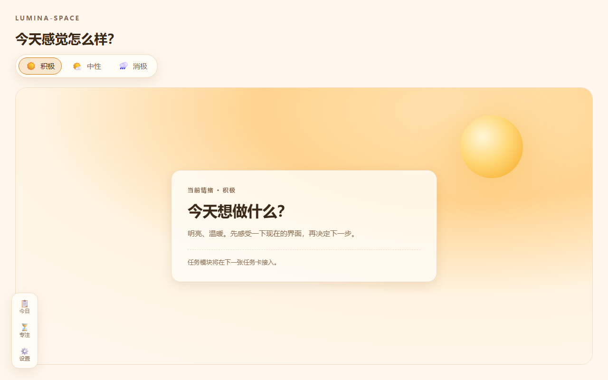
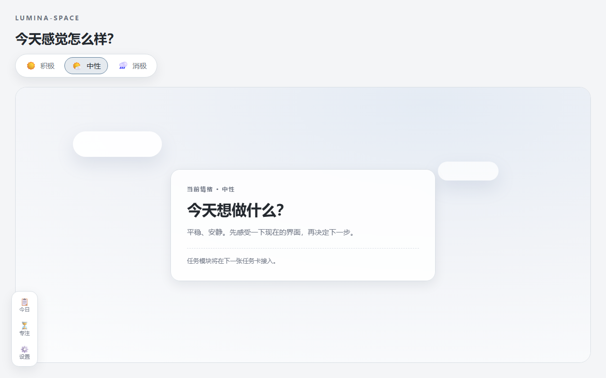
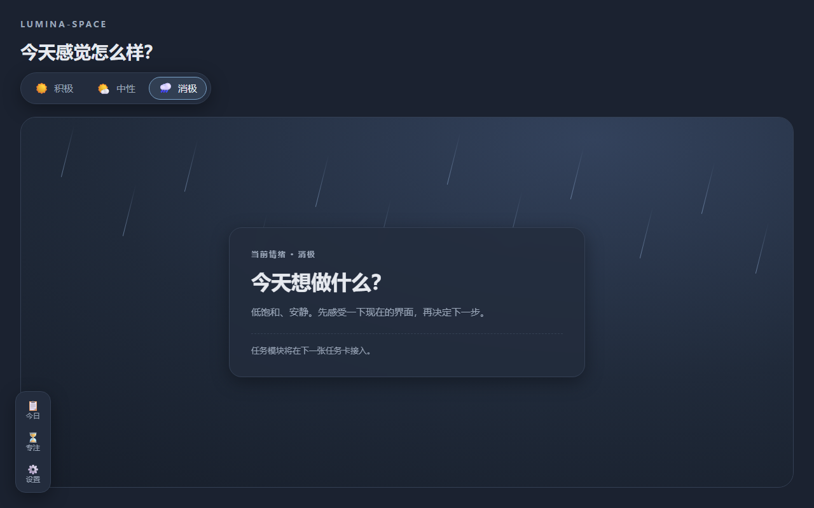
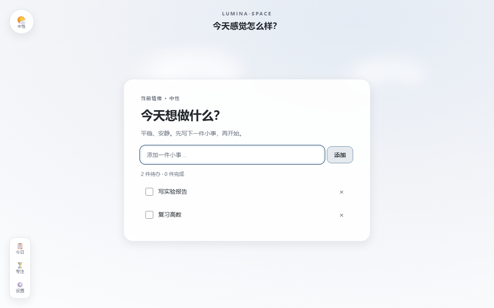
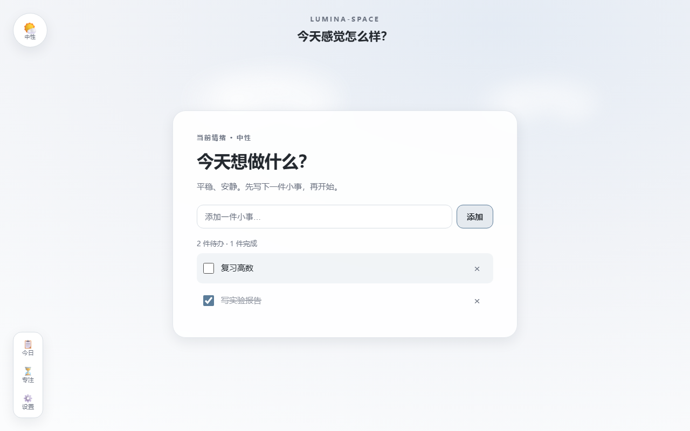
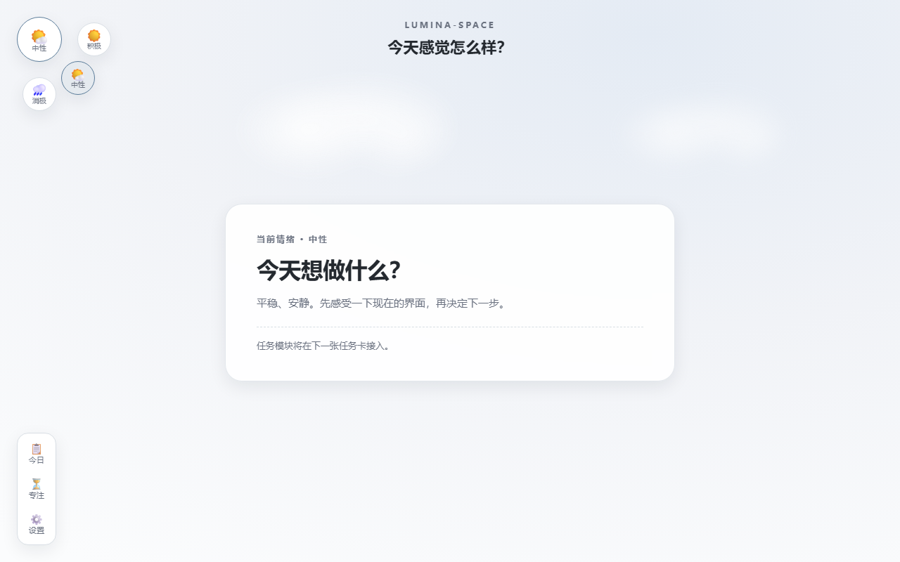
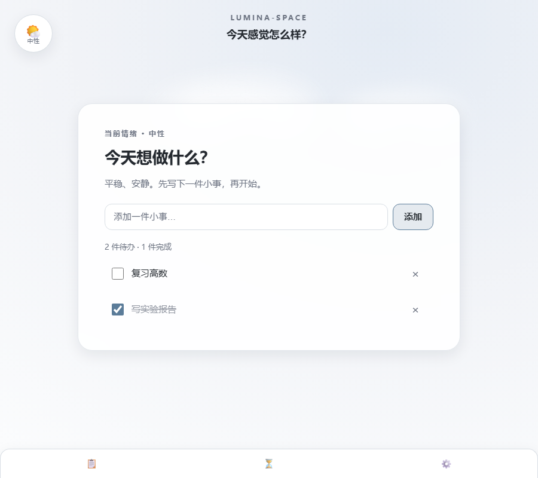

<p align="center">
  
</p>

<h1 align="center">Lumina-Space</h1>

<p align="center">
  <strong>把情绪和待办放在同一张书桌上的沉浸式学习工作台。</strong><br>
  选一个情绪，界面和场景跟着变；先感受，再开始。
</p>

<p align="center">
  <a href="https://lumina-space.cc.cd"><strong>在线使用 → lumina-space.cc.cd</strong></a>
</p>

<p align="center">
  <a href="LICENSE"></a>
  
  
  
  
</p>

<p align="center">
  <a href="#为什么是-lumina-space">为什么</a> ·
  <a href="#现在能做什么">功能</a> ·
  <a href="#截图">截图</a> ·
  <a href="#快速开始">快速开始</a> ·
  <a href="#版本记录">版本</a> ·
  <a href="CHANGELOG.md">更新日志</a>
</p>

---

## 为什么是 Lumina-Space

大多数待办工具只问「做完了吗」。但大学生一天里真正难的那部分，往往发生在打开待办之前：不想开始、不知道自己怎么了、坐下来又静不下来。

Lumina-Space 想把「情绪」放回工作台的第一屏。不是加一个心情打卡，而是让整个界面先接住你：暖一点、冷一点、亮一点、安静一点。然后再问，今天想做什么。

> 这是一张干净的书桌，不是一张 KPI 看板。

## 现在能做什么

- **情绪圆盘**：左上角圆形情绪盘，鼠标移入 / 点击 / Enter 展开积极 / 中性 / 消极三个选项；选中后整站切换主题，刷新后保持。
- **全屏主界面**：场景铺满整个视口，内容卡居中；暖阳、阴天、雨夜三种氛围。
- **待办任务**：在中央卡片添加 / 完成 / 删除任务；未完成优先排序，空列表有空状态；刷新后任务与完成状态保持。
- **左下侧边栏**：今日 / 专注 / 设置三个入口，展开占位面板；Esc 收起；窄屏变底部抽屉。
- **本地优先**：数据只存在浏览器 `localStorage`，没有账号、没有后端。
- **基础质量**：键盘可达、焦点可见、`prefers-reduced-motion` 关闭动效；45 条单元测试。

> 当前 v0.3 开发中：任务 CRUD 已完成；侧边栏抽屉、番茄钟是下一步。v1.0 会把常用功能做齐，v2.0 再做 3D 小屋。

## 截图

| 积极 | 中性 | 消极 |
|---|---|---|
|  |  |  |

**待办（v0.3）**





**情绪圆盘 / 窄屏**





## 快速开始

```bash
git clone https://github.com/Kensh-ux/Lumina-Space.git
cd Lumina-Space
npm install
npm run dev
```

打开终端提示的地址（默认 `http://localhost:5173`）。

## 版本记录

| 版本 | 日期 | 内容 |
|---|---|---|
| v0.1.0 | 2026-10-22 | 框架、三种情绪主题、左下侧边栏、Stage 场景、本地持久化 |
| v0.2.0 | 2026-10-23 | 全屏主界面、情绪圆盘、触屏/键盘交互 |
| v0.3.0 | 开发中 | 任务 CRUD；侧边栏抽屉、番茄钟开发中 |
| v0.4.0 | 计划 | UI 打磨 |
| v1.0.0 | 计划 | 常用功能完整、可发布的主界面 |
| v2.0.0 | 计划 | 3D 小屋 |

完整记录见 [CHANGELOG.md](CHANGELOG.md)。

## License

MIT © 四弦六狸。见 [`LICENSE`](LICENSE)。
